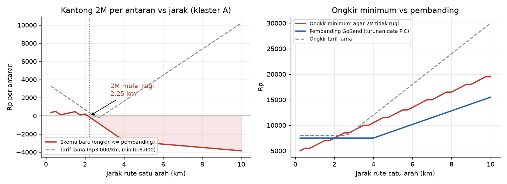
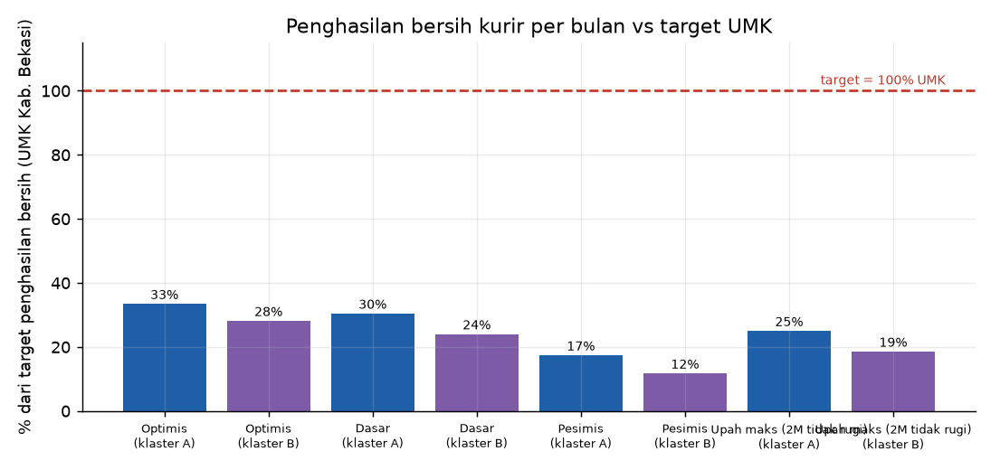
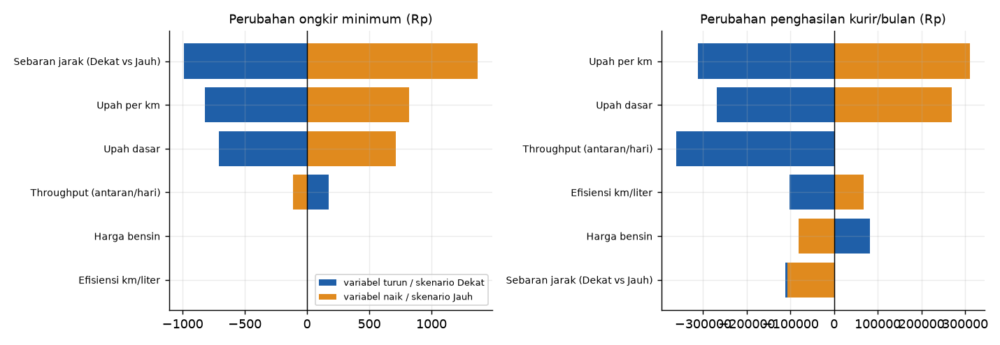
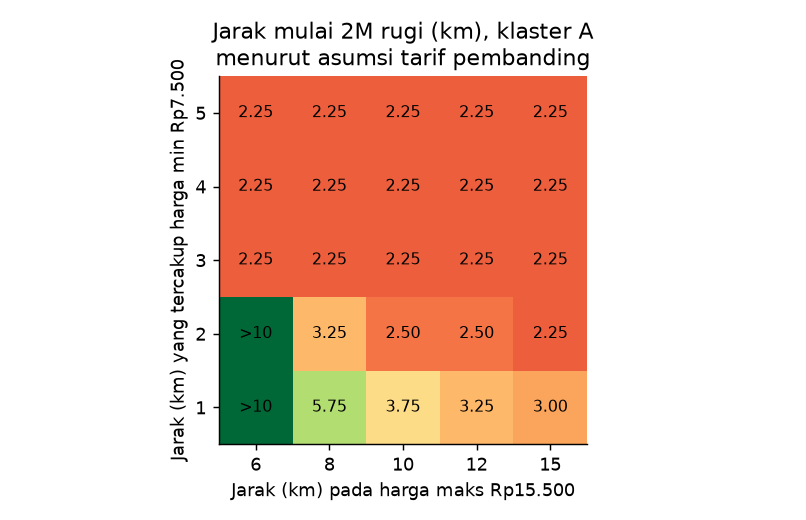
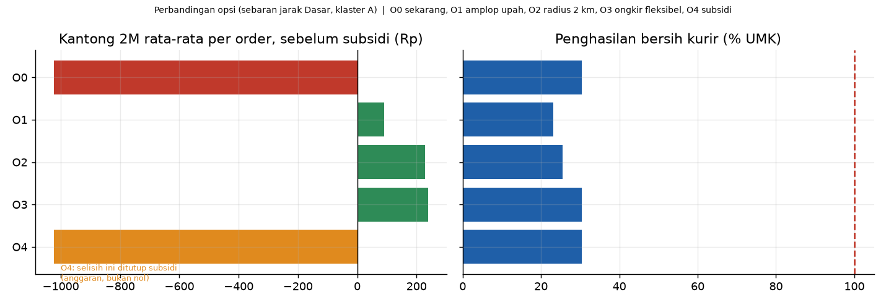

# 02. Laporan Analisis dan Rekomendasi
*Main Quest DS poin 4 dan 5 · Dihasilkan dari `python run_all.py` (angka di `output/tabel/angka_kunci.json`)*

## Ringkasan untuk pengambil keputusan
- **Dengan skema sekarang (upah Rp3.500 + Rp1.500/km, ongkir ≤ GoSend), 2M mulai rugi pada jarak 2,25 km** dan terus rugi sampai 10 km. Pada sebaran jarak "Dasar" (40% / 40% / 20% untuk 0–2, 2–4, >4 km), **60% order rugi** dengan kantong 2M rata-rata −Rp1.022 per order. Menutup semua order yang rugi (tanpa mengurangi dengan order yang untung) butuh subsidi ±Rp1.114 per order.
- **Kurir tidak mencapai target UMK.** Pada skema sekarang penghasilan bersih ±Rp1,81 juta/bulan = **30,4% target** (klaster A) dan 24,0% (klaster B). Untuk 100% target dibutuhkan 50 antaran/hari, sedangkan kapasitas waktu hanya 15.
- **Menutup kesenjangan ke UMK lewat ongkir tidak realistis**: di jarak rata-rata 2,7 km dibutuhkan ongkir ±Rp19.300 (pembanding Rp7.500), selisih ±Rp11.800 per order atau ±Rp4,6 juta per kurir per bulan.
- **Kesimpulan jarak 2,25 km bergantung pada asumsi tarif pembanding yang belum terverifikasi** (Q4). Ini data paling berharga untuk dikonfirmasi berikutnya.
- Tidak ada opsi tunggal yang membuat 2M aman, ongkir ≤ pembanding, *dan* kurir mendekati UMK. Tim perlu memilih kompromi (Q5).

---

## Q1. Pada jarak berapa 2M mulai rugi?

| Jarak satu arah | Kantong 2M per antaran (klaster A, skema sekarang) |
|---|---|
| ≤ 2,00 km | positif (kecil: Rp90–Rp482) |
| **2,25 km** | **mulai negatif (−Rp164)** |
| 3 km | −Rp1.272 |
| 5 km | −Rp2.933 |
| 8 km | −Rp3.486 |
| 10 km | −Rp3.854 |

- 32 dari 40 titik grid (2,25–10 km) rugi; kurir sendiri tidak pernah rugi (untung > 0 di semua jarak).
- Tarif lama (Rp3.000/km, min Rp8.000) hanya rugi di "dead zone" 2,50–2,75 km, tetapi jauh lebih mahal dari pembanding (mis. 4 km: Rp12.000 vs Rp7.500), sehingga tidak kompetitif.
- **Amplop upah** (upah maksimum yang masih membuat 2M tidak rugi bila ongkir = pembanding): Rp6.709 untuk ≤4 km, Rp8.022 di 5 km, Rp11.961 di 8 km. Skema sekarang melewati amplop mulai 3 km (Rp8.000 vs Rp6.709). Tabel lengkap: `output/tabel/q1_amplop_upah_per_jarak.csv`.
- Efek samping: pada upah amplop, untung kurir per jam turun dari Rp15.917 (1 km) menjadi Rp3.782 (4 km). Antaran jauh hampir tidak menguntungkan kurir dan berisiko ditolak.

## Q2. Apakah kurir mencapai target UMK?

| Skenario (klaster A) | Penghasilan bersih/bulan | % target |
|---|---|---|
| Optimis (jarak 2,05 km, 18 antaran/hari) | Rp1.986.597 | 33,5% |
| **Dasar (2,7 km, 15/hari)** | **Rp1.807.851** | **30,4%** |
| Upah dibatasi amplop (2M tidak rugi) | Rp1.484.769 | 25,0% |
| Pesimis (3,6 km, macet, 9/hari) | Rp1.033.817 | 17,4% |

- Untung kurir ±Rp8.914/jam vs target Rp28.552/jam (UMK ÷ 26 hari ÷ 8 jam).
- Kapasitas waktu (15 antaran/hari pada jarak rata-rata) adalah pembatas utama, bukan permintaan.
- Skema upah linear yang mencapai target: dasar ±Rp7.247 + ±Rp3.952/km (klaster A). Ini jauh di atas batas pembanding.

## Q3. Variabel paling sensitif

- **Ongkir minimum** paling bergeser oleh **sebaran jarak order** (−Rp990 s.d. +Rp1.371), lalu upah per km (±Rp823) dan upah dasar (±Rp711).
- **Harga bensin dan efisiensi motor tidak mengubah ongkir minimum** karena biaya motor ditanggung kurir (bukan 2M). Keduanya hanya menggeser penghasilan kurir: harga bensin ±Rp82 ribu per bulan; efisiensi −Rp102 ribu (turun 20%) atau +Rp68 ribu (naik 20%).
- **Penghasilan kurir** paling sensitif terhadap **upah per km** (±Rp311 ribu) dan **throughput** (turun 12 antaran: −Rp362 ribu; naik 18: nol karena sudah dibatasi kapasitas waktu).

## Q4. Seberapa kokoh terhadap asumsi tarif pembanding?

Tarif pembanding diturunkan dari rentang harga (Rp7.500–15.500) dengan dua asumsi yang belum dikonfirmasi: berapa km yang tercakup tarif minimum (4 km) dan pada jarak berapa harga maksimum berlaku (10 km).

- Bila tarif minimum Rp7.500 mencakup **≥ 3 km**, 2M rugi mulai **2,25 km pada semua nilai jarak-harga-maks (6–15 km)**. Kesimpulan Q1 kokoh.
- Bila tarif minimum hanya mencakup **1–2 km**, titik rugi bergeser ke 2,25–5,75 km, dan pada 2 dari 25 kombinasi 2M tidak rugi sampai 10 km.
- Artinya kesimpulan "rugi mulai 2,25 km" hanya aman bila tarif minimum GoSend benar-benar berlaku sampai ±3 km atau lebih. **Satu kali simulasi order di aplikasi pada jarak 1, 3, 5, dan 8 km akan menyelesaikan ini.**

## Q5. Opsi kebijakan (sebaran Dasar, klaster A)

| Opsi | Kantong 2M rata-rata | % UMK kurir | Konsekuensi |
|---|---|---|---|
| O0 Skema sekarang | −Rp1.022 | 30,4% | 60% order rugi |
| O1 Upah dibatasi amplop | +Rp91 | 23,1% | kurir menanggung: untung/jam di >2 km sangat rendah |
| O2 Radius ≤ 2 km | +Rp228 | 25,5% | hanya 40% order terlayani (sebaran Dasar) |
| O3 Ongkir fleksibel di atas pembanding | +Rp239 | 30,4% | premi vs pembanding: −20% (1 km), +20% (3 km), +37% (5,5 km); respons pelanggan belum diuji |
| O4 Subsidi menutup selisih | ditutup anggaran | 30,4% | butuh ±Rp1.114 per order (±Rp1,11 juta per 1.000 order); batas subsidi belum diputuskan |
| *Batching (ilustratif)* | lihat di bawah | | parameter detour dan waktu tambahan adalah asumsi |

**Batching (ilustratif, 3 km, upah dibatasi amplop, detour 0,5 km dan +8 menit per drop tambahan):** untung kurir per jam naik dari Rp6.356 (1 order/trip) menjadi Rp17.100 (3 order) dan Rp25.158 (8 order), namun **tetap di bawah target Rp28.552/jam**. Batching adalah tuas penghasilan terbesar, tetapi sendirian tidak cukup. Detail: `q6_batching_ilustratif.csv`.

## Rekomendasi (untuk keputusan PM, bukan keputusan DS)
1. **Jangan meluncurkan skema upah sekarang bersama ongkir ≤ GoSend tanpa penyesuaian.** Hasilnya rugi struktural untuk order >2 km.
2. **Untuk pilot, kombinasikan O2 dan O3 secara bertahap:** layani ≤2 km dengan ongkir ≤ pembanding; untuk >2 km uji ongkir bertingkat (premi ±20–37%) pada sebagian pelanggan dan ukur penurunan order.
3. **Uji batching di pilot**, karena ini satu-satunya tuas yang menaikkan penghasilan kurir per jam secara signifikan tanpa menaikkan ongkir.
4. **Tinjau ulang target "100% UMK".** Dengan ongkir ≤ pembanding, tidak ada skenario yang mendekatinya. Pilihannya: (a) kurir diposisikan paruh waktu/fleksibel dengan target per jam yang setara pendapatan driver pembanding, (b) subsidi dari margin produk, atau (c) ongkir lebih tinggi. Pilihan (b) hanya bisa diputuskan setelah contribution margin per order diketahui (butuh data HPP).
5. **Konfirmasi tarif pembanding di aplikasi sebelum angka ini dipakai untuk menetapkan harga** (Q4).

## Batasan
- Seluruh angka berasal dari model skenario dengan asumsi tim; belum divalidasi data transaksi nyata.
- Klaster A dan B dilaporkan; klaster A dipakai sebagai acuan di grafik. Klaster B lebih rendah sekitar 6 poin persen UMK pada skenario Dasar.
- Kurir diasumsikan satu pengiriman per perjalanan (tanpa batching) kecuali pada bagian batching ilustratif.
